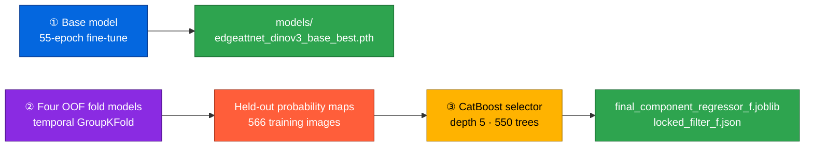

<div align="center">


<br/>


**A DINOv3 ConvNeXt-Base encoder with an edge-guided attention decoder, eight-way test-time augmentation, and a learned CatBoost instance selector.**

[**▶ Run the pipeline**](final_inference.ipynb) &nbsp;·&nbsp; [Method](docs/METHOD.md) &nbsp;·&nbsp; [Training](docs/TRAINING.md) &nbsp;·&nbsp; [OOF models](docs/OOF_MODELS.md) &nbsp;·&nbsp; [Evaluation](docs/EVALUATION.md) &nbsp;·&nbsp; [Release checklist](docs/RELEASE_CHECKLIST.md)

</div>

---

## Contents

1. [Overview](#-overview)
2. [Results and configuration](#-results-and-configuration)
3. [Quick start: reproduce the submission](#-quick-start-reproduce-the-submission)
4. [Outputs](#-outputs)
5. [Retraining from scratch](#-retraining-from-scratch)
6. [Artifacts and provenance](#-artifacts-and-provenance)
7. [Reproducibility statement](#-reproducibility-statement)
8. [Repository guide](#-repository-guide)
9. [Verification](#-verification)
10. [Competition requirements](#-competition-requirements)
11. [References](#-references)

---

## ☀️ Overview

EdgeAttNet segments individual solar filaments in full-resolution (2048 × 2048) H-alpha images. The system works in three stages:

1. **Dense prediction.** A DINOv3 ConvNeXt-Base encoder feeds a multiscale decoder with two edge-guided multi-head self-attention blocks. The network outputs a per-pixel filament probability map.
2. **Instance extraction.** The probability map is averaged over eight test-time augmentations (the D4 group of rotations and flips). Hysteresis thresholding then turns it into candidate filament instances.
3. **Learned selection.** A 31-feature CatBoost regressor scores each candidate and removes likely false positives.


Test inference reads **H-alpha images only**. It never touches test labels or a precomputed submission, and it performs no tuning: every threshold is fixed by the frozen filter configuration.

## 📊 Results and configuration

| Component | Selected configuration |
| --- | --- |
| Encoder | DINOv3 ConvNeXt-Base (official pretrained initialization) |
| Decoder | EdgeAttNet, multiscale, two edge-guided attention blocks (4 heads each) |
| Input | Grayscale, scaled to [0, 1], native 2048 × 2048 |
| Inference | D4 / TTA8, probabilities averaged at native resolution, quantized to FP16 |
| Instance extraction | Hysteresis (support 0.15, seed 0.90), minimum 150 pixels |
| Instance selection | 31-feature CatBoost regressor (depth 5, 550 trees), cutoff 0.25 |
| Output encoding | Fortran-order COCO RLE, one row per filament |
| Validation protocol | 566 / 141 physical-image split, pooled multi-annotator PQ |
| **Reported validation PQ** | **0.4751** |

The validation score is pooled over all image–annotator pairs (IoU > 0.5 matching), not averaged per image. The metric definitions are in [`docs/EVALUATION.md`](docs/EVALUATION.md). The 0.4751 figure was **reproduced exactly** by a clean rerun of `final_inference.ipynb` on Kaggle (15 November 2026); see the [reproducibility statement](#-reproducibility-statement).

### Models and stack

| Role | Model / Tool | Details |
| --- | --- | --- |
| **Encoder** |  | Pretrained backbone, fine-tuned for this task (no self-supervised pretraining here) |
| **Decoder** |  | Edge prior added to attention queries and keys; GroupNorm throughout |
| **Selector** |  | Regressor trained on out-of-fold predictions; keeps candidates scoring ≥ 0.25 |
| **Framework** |  | CUDA 13.0 runtime |
| **Weights hosting** |  | Three inference artifacts plus four OOF fold checkpoints |

### Pinned versions

| Component | Version | |
| --- | --- | --- |
| Python | `3.11` / `3.12` |  |
| PyTorch | `2.11.0` |  |
| CUDA | `13.0` |  |

The full dependency list is in [`requirements.txt`](requirements.txt). These pins are proposed, not a recovered historical freeze. Each run records the actual versions in `environment.txt`.

---

## 🚀 Quick start: reproduce the submission

**Requirements:** a CUDA GPU and the official [competition dataset](https://www.kaggle.com/competitions/filament-segmentation-2026/data). The default notebook loads trained weights, so **no training is needed**.

### 1. Get the code

```bash
git clone https://github.com/esraakh299/EdgeAttNet-DINOv3-Filament-Segmentation.git
cd EdgeAttNet-DINOv3-Filament-Segmentation
```

Alternatively, extract the provided source ZIP. On Kaggle, attach the competition data and enable a GPU and Internet; you can also upload only `final_inference.ipynb`, since its first cell fetches this repository into `/kaggle/working` automatically (it does nothing when the notebook is opened from a clone).

### 2. Install dependencies

```bash
python -m pip install -r requirements.txt
```

Use Python 3.11 or 3.12 on Linux with an NVIDIA GPU. Restart any existing notebook kernel after installation.

### 3. Run the notebook

Open [`final_inference.ipynb`](final_inference.ipynb) and run all cells.

- Set `REPO_ROOT` if the notebook lives outside the checkout, and `DATA_ROOT` if running outside Kaggle.
- For local Jupyter, launch with `jupyter lab final_inference.ipynb`.
- Keep the three training switches (`TRAIN_FROM_SCRATCH`, `TRAIN_OOF_FROM_SCRATCH`, `TRAIN_FILTER_FROM_SCRATCH`) set to `False`.
- The three inference artifacts download automatically from a pinned public Hugging Face revision, with no authentication.

> [!TIP]
> **Offline use:** place the three files listed in [`models/README.md`](models/README.md) in `models/` (or point the `EDGEATTNET_MODEL_DIR` environment variable at them) and set `ALLOW_PUBLIC_DOWNLOAD = False`.

---

## 📦 Outputs

Results are written to `/kaggle/working/edgeattnet_results/` on Kaggle and to `outputs/` elsewhere.

| File | Contents |
| --- | --- |
| `submission.csv` | One COCO-RLE row per predicted filament, in the official two-column schema (`filament_id`, `segmentation_rle`) |
| `validation_metrics.csv` | Pooled PQ, SQ, RQ, TP, FP and FN over the 141 validation images |
| `validation_per_image.csv` | Candidate and accepted counts and matched-IoU sums for each validation image |
| `preview.png` | Input, probability map and accepted-instance outlines for the first sorted test image |
| `run_manifest.json` | Artifact and split SHA-256 values, runtime, configuration and results |
| `environment.txt` | Package versions from the execution environment |

The preview image is chosen deterministically (first sorted test file), not by quality, so it is an honest sample of the output morphology.

---

## 🔁 Retraining from scratch

Retraining is **optional**. The default notebook path uses published artifacts. Three independent stages can be rebuilt, either through the notebook switches or directly from the command line.



### What you need

| Requirement | Notes |
| --- | --- |
| Official competition data | Images and the complete COCO annotation JSON |
| Bundled split tables and masks | Included in `data/` (566 / 141 split; 1,154 semantic and spine mask pairs) |
| **DINOv3 ConvNeXt-Base encoder state-dict** | Official pretrained weights, mounted as a local file. Access may be gated upstream, so inference never depends on it |
| CUDA GPU | One GPU for base training; **two GPUs** for the paired OOF fold workflow |
| Time | Training spans several GPU sessions. Runs are resumable: keep the whole output directory and re-run |

Install the training extras and validate the bundled masks first:

```bash
python -m pip install -r requirements-train.txt
python scripts/prepare_training_assets.py
```

### ① Base segmentation model

```bash
python scripts/retrain_base.py \
  --encoder /path/to/dinov3_convnext_base_state_dict.pth \
  --data-root /path/to/MAGFiLO_1.0_Kaggle_2026 \
  --output-root outputs/training

python scripts/export_model.py \
  --source outputs/training/dino_convnext_base/dice_best_ema.pth \
  --output models/edgeattnet_dinov3_base_best.pth
```

Recipe: GroupNorm, balanced augmentation, 1024 px crops, AdamW, mixed precision, EMA 0.99 and a 55-epoch Dice stage with a fixed-PQ checkpoint-selection monitor. The submitted checkpoint is the epoch-50 EMA state. The launcher refuses to export a partial run: it requires `run_complete.json`.

### ② Out-of-fold models

The four fold models exist only to generate **held-out probability maps** for training the selector. They are not an inference ensemble. The recipe uses four temporal GroupKFold splits with a 2-day embargo, seed 42, and a fixed epoch-55 EMA checkpoint per fold. The 141 validation images are excluded from all four fits.

```bash
# Default: use the published fold weights (hash-checked, no retraining)
python scripts/run_oof_pair.py --folds 01 --mode pretrained \
  --data-root /path/to/MAGFiLO_1.0_Kaggle_2026 --splits-root data/splits \
  --output outputs/DINO_OOF_Folds01 --hf-repo youssefElghanam191/edgeattnet-dinov3-convnext-base
python scripts/run_oof_pair.py --folds 23 --mode pretrained \
  --data-root /path/to/MAGFiLO_1.0_Kaggle_2026 --splits-root data/splits \
  --output outputs/DINO_OOF_Folds23 --hf-repo youssefElghanam191/edgeattnet-dinov3-convnext-base

# Optional: retrain the fold models (two GPUs; add --encoder for each pair)
#   --mode train --encoder /path/to/dinov3_convnext_base_state_dict.pth
```

The equivalent notebooks are [`04_OOF_Folds_01`](notebooks/04_OOF_Folds_01.ipynb) and [`05_OOF_Folds_23`](notebooks/05_OOF_Folds_23.ipynb) (`TRAIN_OOF_FROM_SCRATCH = False` by default). Fold metadata is generated automatically from the bundled manifests in `data/oof/`, after each downloaded weight is verified against its pinned SHA-256. No extra JSON uploads are needed. Details: [`docs/OOF_MODELS.md`](docs/OOF_MODELS.md).

### ③ CatBoost selector

First audit that the 566 held-out maps are complete and consistent, then fit the selector:

```bash
python scripts/audit_oof_coverage.py \
  --pair-01 outputs/DINO_OOF_Folds01 \
  --pair-23 outputs/DINO_OOF_Folds23 \
  --out outputs/oof_verified

python scripts/fit_filter_oof.py \
  --dataset /path/to/MAGFiLO_1.0_Kaggle_2026 \
  --splits data/splits \
  --oof outputs/oof_verified \
  --out outputs/learned_filter
```

Each candidate's training target is the sum of its IoU > 0.5 matches across annotators, averaged over annotators. The fit uses the locked configuration (CatBoost depth 5, 550 iterations, learning rate 0.035, L2 6, RMSE, seed 42) and writes `final_component_regressor_f.joblib` and `locked_filter_f.json`. Only training-only out-of-fold maps are used, never in-sample predictions from the final model.

### Using retrained artifacts

Place the exported files in `models/` (or set `EDGEATTNET_MODEL_DIR`). A model-only export named `edgeattnet_dinov3_base_best.pth` takes precedence over the wrapped snapshot, and all model keys load strictly. Then run `final_inference.ipynb` as usual.

---

## 🔐 Artifacts and provenance

Binaries are **not** embedded in the source ZIP. They are hosted publicly, need no login, and are pinned by revision.

| Artifact | File | Role |
| --- | --- | --- |
| Segmentation model | `dice_best_ema.pth` | Selected EMA snapshot, loaded with `weights_only=True` |
| Instance selector | `final_component_regressor_f.joblib` | Trained 31-feature CatBoost regressor |
| Frozen decoding config | `locked_filter_f.json` | Feature order and decision thresholds (0.15 / 0.90 / 150 / 0.25) |

- **Inference artifacts:** [`youssefElghanam191/edgeattnet-dinov3-convnext-base`](https://huggingface.co/youssefElghanam191/edgeattnet-dinov3-convnext-base) at revision `f432bda8b3545e7f3736bdceecdb8698c406ff8c`.
- **OOF fold weights:** same repository at revision `19cc13b207a30795459b86d80cc36662fff289a0`, recorded with SHA-256 values in [`data/oof/release.json`](data/oof/release.json).
- **Bundled data integrity:** SHA-256 values for the split tables and training masks are in [`data/ASSET_SHA256.json`](data/ASSET_SHA256.json).
- **Run evidence:** every notebook run writes the SHA-256 of the weights, selector, config and split tables to `run_manifest.json`.

> [!WARNING]
> `joblib` is a pickle-based format. Load selector files only from sources you trust.

---

## 🧾 Reproducibility statement

We distinguish what is guaranteed from what is expected.

| Component | Status |
| --- | --- |
| Inference code (TTA8, hysteresis, features, selection, RLE export) | Complete in `src/`. Runs end to end from pinned artifacts |
| Thresholds and feature order | Fixed by the frozen config. No tuning at inference time |
| Data splits and training targets | Bundled and integrity-checked |
| Reported PQ 0.4751 | **Reproduced exactly** by a clean rerun of `final_inference.ipynb` on Kaggle (15 November 2026), from the pinned artifacts |
| Runtime environment | Pinned versions are proposed. Small numerical differences (CUDA, cuDNN, GPU) can change a borderline selector decision |
| Retraining the base or fold models | Expected to be close but **not bit-identical**, owing to GPU nondeterminism |
| Refitting the selector | Uses the locked recipe. It does not repeat the historical selector search, so the model bytes may differ from the published file |

Reference notes on CUDA 13.0 and the earlier CUDA 12.8 parity check are in [`docs/EVALUATION.md`](docs/EVALUATION.md). To audit a run, compare the generated `validation_metrics.csv` and `run_manifest.json` against the values above.

---

## 🗂️ Repository guide

```text
.
├── final_inference.ipynb        Single entry point for reviewers
├── src/                         Architecture, data, inference, filtering, training workers
├── scripts/                     Asset prep, model export, OOF runner/audit, filter fit
├── notebooks/                   Optional: base training, filter training, OOF folds
├── data/
│   ├── splits/                  Fixed 566 / 141 split tables
│   ├── oof/                     Original fold manifests and published-weight hashes
│   └── assets/                  Checked training-target archive (masks)
├── models/                      Artifact instructions and optional local model files
├── docs/                        Method, training, OOF, evaluation, release notes
├── tests/                       CPU contract and artifact-resolution checks
└── assets/                      README banner
```

| Document | Covers |
| --- | --- |
| [`docs/METHOD.md`](docs/METHOD.md) | Preprocessing, network, probability-to-instance pipeline, selector |
| [`docs/TRAINING.md`](docs/TRAINING.md) | Training recipe and the optional training branch |
| [`docs/OOF_MODELS.md`](docs/OOF_MODELS.md) | Fold models, held-out maps, filter fitting |
| [`docs/EVALUATION.md`](docs/EVALUATION.md) | Pooled PQ / SQ / RQ protocol and runtime notes |
| [`docs/BUNDLED_DATA.md`](docs/BUNDLED_DATA.md) | Contents and integrity of bundled data |
| [`docs/RELEASE_CHECKLIST.md`](docs/RELEASE_CHECKLIST.md) | Submission requirements and acceptance run |

Training source is retained because it is needed to explain and reproduce the method. Experimental notebooks, backup documentation, duplicate inference notebooks and the historical submission CSV have been removed.

---

## ✅ Verification

```bash
python -m pip install -r requirements-dev.txt
python -m pytest -q
```

The release passes 22 CPU tests covering the contracts, artifact resolution (including anonymous pinned download and offline cases), and OOF provenance. The four hosted fold checkpoints and the final segmentation model load strictly on CPU, and the published selector scores a synthetic candidate through the real feature-extraction path. These tests check software contracts. They do **not** establish GPU reproducibility or the reported PQ.

---

## 🏆 Competition requirements

The organizers additionally require a **four-page technical report** in their template and completion of their submission form. Both are separate from this source package. The public repository must remain accessible through the winner announcement; see the [official instructions](https://www.kaggle.com/competitions/filament-segmentation-2026/overview/announcements). The full requirement-by-requirement checklist is in [`docs/RELEASE_CHECKLIST.md`](docs/RELEASE_CHECKLIST.md).

---

## 📚 References

- [Competition and evaluation requirements](https://www.kaggle.com/competitions/filament-segmentation-2026/overview/announcements)
- [Organizer self-evaluation notebook](https://www.kaggle.com/code/azimahmadzadeh/self-evaluation-notebook)
- [MAGFiLO dataset paper](https://doi.org/10.1038/s41597-024-03876-y)
- [DINOv3 source and pretrained models](https://github.com/facebookresearch/dinov3)
- [Published model artifacts](https://huggingface.co/youssefElghanam191/edgeattnet-dinov3-convnext-base)

Third-party model and dataset terms remain applicable. This repository does not assign a new license to the team's source code.